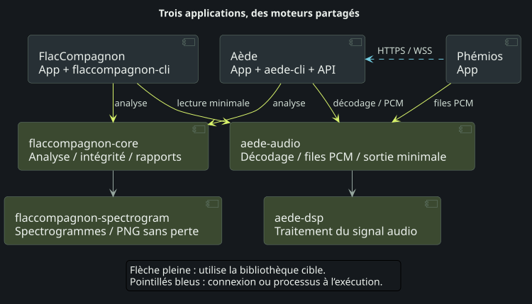
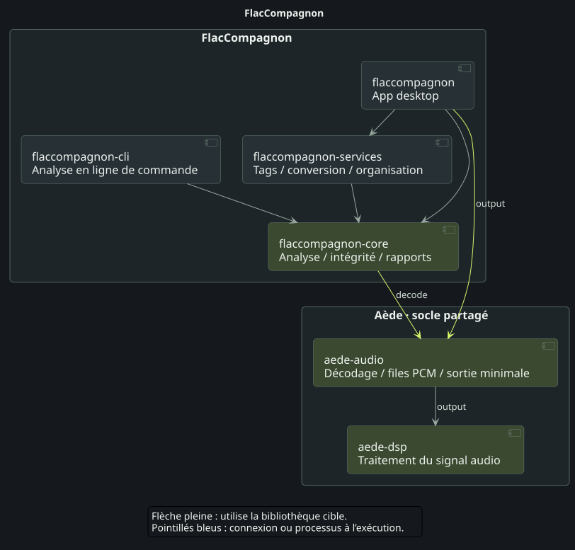
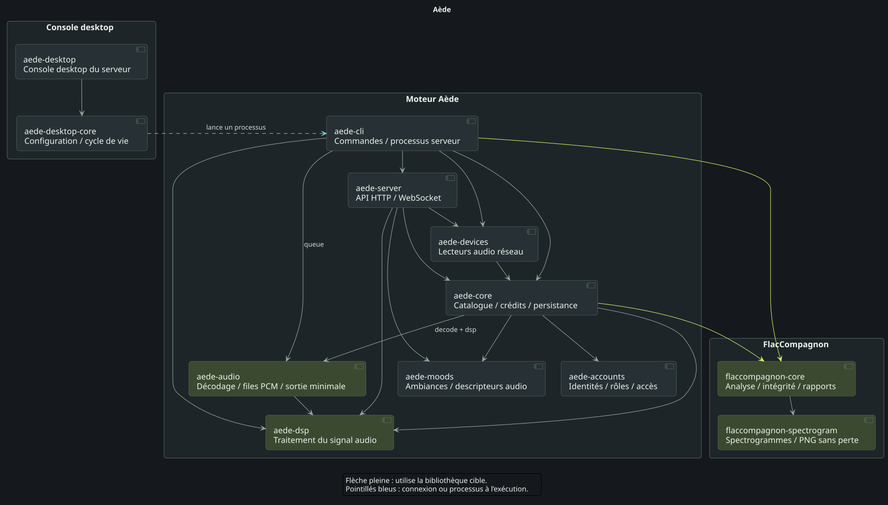
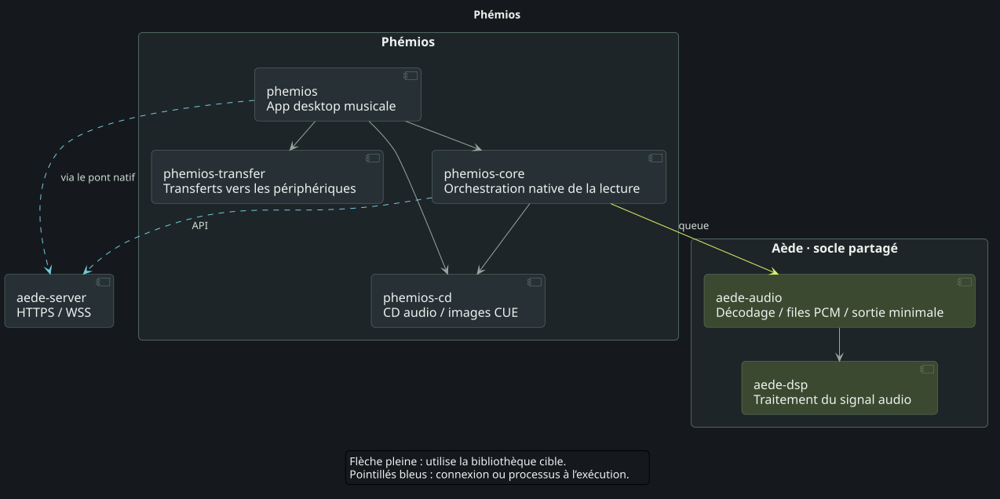
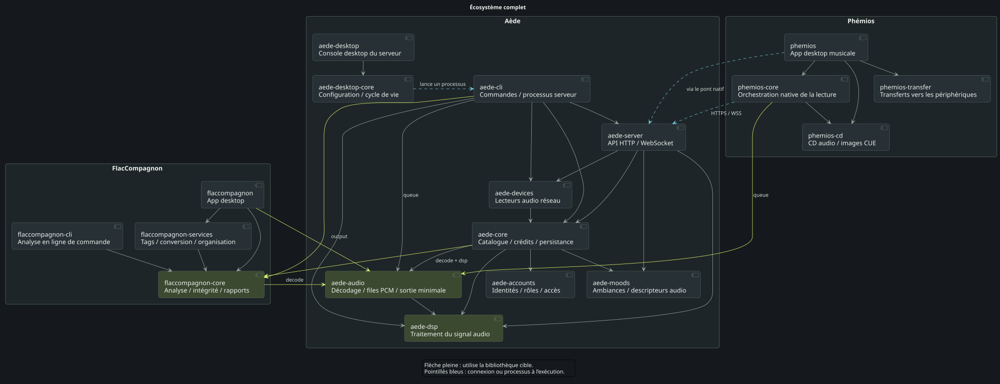

# Trois applications, des crates partagées

FlacCompagnon analyse la qualité et l’intégrité des fichiers audio. Aède organise le catalogue musical, ses métadonnées et ses accès, et fournit les services de lecture et de serveur. Phémios est l’interface pour explorer cette bibliothèque et écouter sa musique.

Leurs crates Rust partagent deux socles : `flaccompagnon-core` pour les analyses et son moteur indépendant `flaccompagnon-spectrogram` pour le calcul spectral et le rendu PNG sans perte, ainsi que `aede-audio` / `aede-dsp` pour les primitives de lecture audio. La vue d’ensemble présente ces réutilisations ; les trois schémas dépliables détaillent ensuite les composants de chaque application. Un diagramme complet réunit toutes les crates en fin de page.

## Vue d’ensemble

<figure class="ecosystem-diagram"><figcaption>Partage du moteur d’analyse et du socle audio</figcaption></figure>

[Ouvrir le SVG](../../../site/assets/architecture/fr-overview.svg) · [PNG](../../../site/assets/architecture/fr-overview.png) · [PlantUML](../../diagrams/ecosystem/fr-overview.puml)

- Les **flèches vertes** identifient les bibliothèques réutilisées entre projets. Les deux crates du socle audio sont maintenues dans Aède ; les moteurs d’analyse et de spectrogrammes sont maintenus dans FlacCompagnon.
- Les **flèches pleines** pointent vers la bibliothèque utilisée. La vue d’ensemble regroupe les rôles des applications, sans énumérer toutes les dépendances Cargo.
- Les **flèches bleues pointillées** représentent des communications à l’exécution. Phémios dialogue avec Aède en HTTPS/WSS, avec un moteur local embarqué ou un serveur distinct.

## Dans chaque application

### FlacCompagnon — analyser et examiner

`flaccompagnon` est l’App desktop ; `flaccompagnon-cli` est l’analyseur en ligne de commande. Ils utilisent `flaccompagnon-core`, tandis que `flaccompagnon-services` gère l’édition des tags, les conversions et l’organisation des fichiers.

`flaccompagnon-spectrogram` appartient à FlacCompagnon et ne dépend ni de Tauri, ni d’un décodeur audio, ni d’une application. `flaccompagnon-core` l’utilise et réexporte son API avec un adaptateur de lecture des fichiers. Aède réutilise ce même moteur par sa dépendance à `flaccompagnon-core` ; il n’en maintient pas une copie.

FlacCompagnon n’embarque pas et ne lance pas `aede-cli`. Sa CLI est bien `flaccompagnon-cli` ; seules les bibliothèques audio d’Aède sont réutilisées pour la préécoute.

L’App utilise `aede-audio/output` pour une lecture locale minimale, sans serveur ni compte Aède, normalisation ou fondu. Son cœur utilise aussi `aede-audio/decode` pour les fonctions de lecture. L’analyse conserve son propre décodage et ses mesures à la précision d’origine : les traitements de préécoute ne modifient pas ses résultats.

Voir les crates de FlacCompagnon

<figure class="ecosystem-diagram"><figcaption>Voir les crates de FlacCompagnon</figcaption></figure>

[Ouvrir le SVG](../../../site/assets/architecture/fr-flaccompagnon.svg) · [PNG](../../../site/assets/architecture/fr-flaccompagnon.png) · [PlantUML](../../diagrams/ecosystem/fr-flaccompagnon.puml)

### Aède — catalogue, serveur et lecture

`aede-core` gère le catalogue, les crédits et la persistance. Il s’appuie sur `aede-accounts` pour les règles de compte, `aede-moods` pour une sélection explicable des ambiances et la bibliothèque d’analyse de FlacCompagnon. `aede-server` expose l’API et utilise `aede-devices` pour les lecteurs réseau. `aede-cli` orchestre les commandes et peut lancer le serveur.

`aede-audio` fournit le décodage progressif et les files PCM bornées ; `aede-dsp` porte les algorithmes communs de traitement du signal. La console desktop possède ses propres crates, `aede-desktop` et `aede-desktop-core` : elle lance l’exécutable du moteur dans un processus enfant, sans réimplémenter le serveur.

Voir les crates d’Aède

<figure class="ecosystem-diagram"><figcaption>Voir les crates d’Aède</figcaption></figure>

[Ouvrir le SVG](../../../site/assets/architecture/fr-aede.svg) · [PNG](../../../site/assets/architecture/fr-aede.png) · [PlantUML](../../diagrams/ecosystem/fr-aede.puml)

### Phémios — explorer et écouter

`phemios` est l’enveloppe desktop Tauri. `phemios-core` gère l’orchestration native et l’intégration de la lecture, avec les primitives communes `aede-audio/queue`. `phemios-cd` fournit la lecture locale des CD audio et images CUE ; `phemios-transfer` gère les transferts vers les périphériques.

La connexion à l’API Aède est distincte de la réutilisation des crates. Pour la lecture de la bibliothèque, Phémios reçoit le PCM traité par Aède et garde ses responsabilités de transport et de sortie côté client ; il ne normalise pas une seconde fois ce flux. La lecture des CD locaux ne nécessite pas de connexion à un compte Aède.

Voir les crates de Phémios

<figure class="ecosystem-diagram"><figcaption>Voir les crates de Phémios</figcaption></figure>

[Ouvrir le SVG](../../../site/assets/architecture/fr-phemios.svg) · [PNG](../../../site/assets/architecture/fr-phemios.png) · [PlantUML](../../diagrams/ecosystem/fr-phemios.puml)

## Un socle commun, des fonctionnalités choisies

`aede-audio` n’active aucune fonctionnalité par défaut. `decode` ajoute le décodage progressif ; `dsp` expose le DSP ; `queue` ajoute les files PCM bornées ; `output` combine ces primitives pour un lecteur minimal sur la sortie audio. Chaque application choisit le profil dont elle a besoin. Partager une crate n’active pas toutes les fonctions de lecture d’Aède dans chaque application.

La préparation des builds natifs des clients sélectionne une version stable publiée d’Aède et conserve sa révision exacte. Une commande Cargo directe utilise l’épinglage existant. Les schémas décrivent l’architecture des sources actuelles, sans garantir que des applications construites indépendamment utilisent des versions identiques.

Les schémas couvrent les 19 crates de production des trois dépôts, y compris le workspace desktop indépendant d’Aède. Les dépendances tierces, de build et de développement, ainsi que la crate de test `phemios-glib-regression`, sont omises. Ils ne certifient pas la compatibilité des appareils physiques.

Pour les limites des fonctionnalités et les règles de mise à jour, consultez le [socle audio commun](../../design/shared-audio.md). Poursuivez avec l’[App serveur](../desktop.md) ou l’[API native](../api.md).

## Écosystème complet

Cette vue réunit les 19 crates et leurs dépendances directes entre projets ou au sein de chaque projet. Chaque cadre indique le dépôt qui maintient les crates : `aede-cli` appartient à Aède, `flaccompagnon-cli` à FlacCompagnon. Les liaisons bleues restent des communications à l’exécution, distinctes des dépendances Cargo. Ouvrez le SVG pour examiner le schéma en grand.

<figure class="ecosystem-diagram"><figcaption>Les trois programmes et leurs bibliothèques partagées, réunis dans une seule vue</figcaption></figure>

[Ouvrir le SVG](../../../site/assets/architecture/fr-complete.svg) · [PNG](../../../site/assets/architecture/fr-complete.png) · [PlantUML](../../diagrams/ecosystem/fr-complete.puml)
