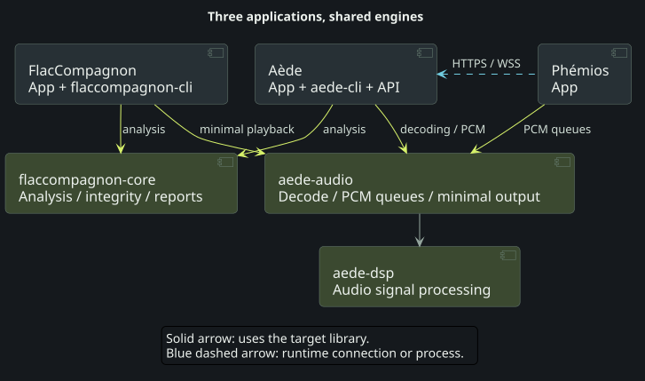
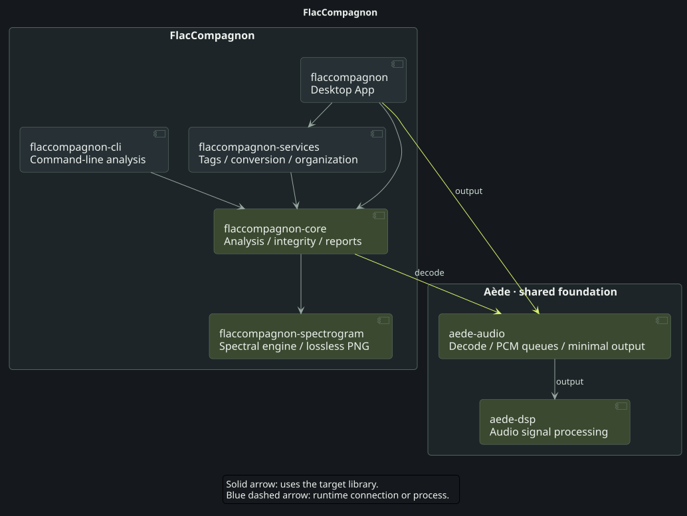
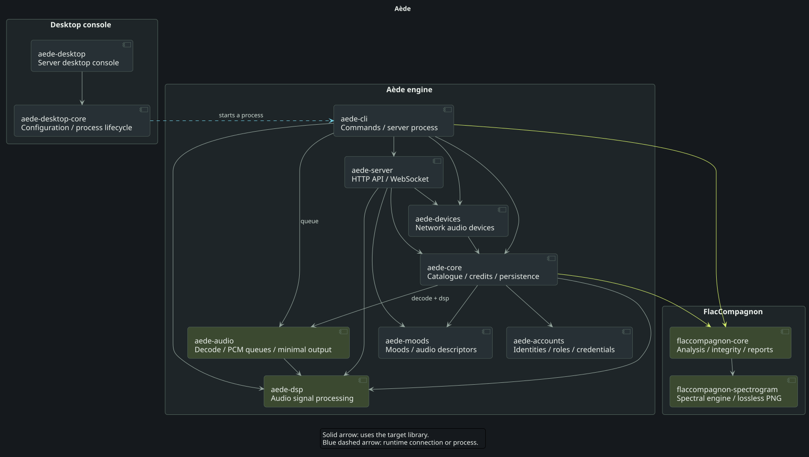
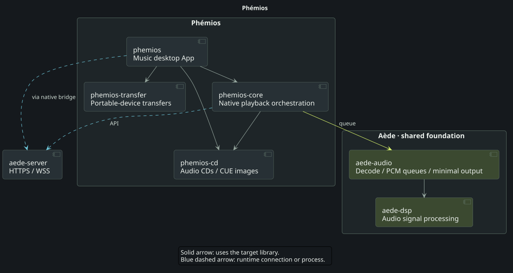
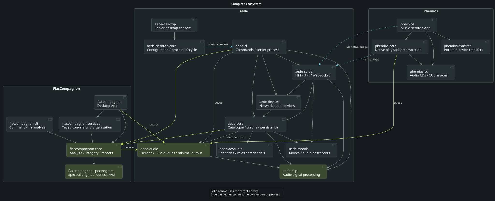

# Three applications, shared crates

FlacCompagnon checks audio quality and integrity. Aède organizes the music catalogue, its metadata and access, and supplies server and playback services. Phémios is the interface for exploring the library and listening to music.

Their Rust crates share two foundations: `flaccompagnon-core` for analysis, and `aede-audio` / `aede-dsp` for audio playback primitives. The overview shows these reuse boundaries; the three expandable diagrams below show each application's own components. A complete diagram brings every crate together at the end of the page.

## At a glance

<figure class="ecosystem-diagram"><figcaption>Shared analysis and audio foundations</figcaption></figure>

[Open SVG](../../site/assets/architecture/en-overview.svg) · [PNG](../../site/assets/architecture/en-overview.png) · [PlantUML](../diagrams/ecosystem/en-overview.puml)

- **Green arrows** identify libraries reused across projects. The two shared audio crates are maintained in Aède; the analysis crate is maintained in FlacCompagnon.
- **Solid arrows** point to the library used. The overview groups application roles rather than enumerating every Cargo dependency.
- **Blue dashed arrows** describe runtime communication. Phémios talks to Aède over HTTPS/WSS, with either an embedded local engine or a separate server.

## Inside each application

### FlacCompagnon — analyze and inspect

`flaccompagnon` is the desktop App; `flaccompagnon-cli` is the command-line analyzer. They use `flaccompagnon-core`, while `flaccompagnon-services` owns tag editing, conversions and file organization.

FlacCompagnon does not embed or launch `aede-cli`. Its CLI is `flaccompagnon-cli`; only Aède's audio libraries are reused for preview playback.

The App uses `aede-audio/output` for minimal local playback, without an Aède server/account, normalization or crossfade. Its core also uses `aede-audio/decode` for playback helpers. Actual analysis keeps its own original-precision decoding and measurements: preview processing does not alter analysis results.

Explore FlacCompagnon crates

<figure class="ecosystem-diagram"><figcaption>Explore FlacCompagnon crates</figcaption></figure>

[Open SVG](../../site/assets/architecture/en-flaccompagnon.svg) · [PNG](../../site/assets/architecture/en-flaccompagnon.png) · [PlantUML](../diagrams/ecosystem/en-flaccompagnon.puml)

### Aède — catalogue, server and playback

`aede-core` owns the catalogue, credits and persistence. It works with `aede-accounts` for account rules, `aede-moods` for explainable atmosphere selection, and FlacCompagnon's analysis library. `aede-server` exposes the API and uses `aede-devices` for network players. `aede-cli` orchestrates commands and can run the server.

`aede-audio` supplies progressive decoding and bounded PCM handoff; `aede-dsp` owns shared signal-processing algorithms. The desktop console has its own crates, `aede-desktop` and `aede-desktop-core`: it launches the engine executable as a child process instead of implementing a second server.

Explore Aède crates

<figure class="ecosystem-diagram"><figcaption>Explore Aède crates</figcaption></figure>

[Open SVG](../../site/assets/architecture/en-aede.svg) · [PNG](../../site/assets/architecture/en-aede.png) · [PlantUML](../diagrams/ecosystem/en-aede.puml)

### Phémios — explore and listen

`phemios` is the Tauri desktop shell. `phemios-core` owns native orchestration and playback integration, using the shared `aede-audio/queue` primitives. `phemios-cd` supplies local audio-CD and CUE-image playback; `phemios-transfer` handles portable-device transfers.

The Aède API connection is distinct from crate reuse. For library playback, Phémios receives Aède-processed PCM and retains its client output/transport responsibilities; it does not normalize the same stream a second time. Local CD playback does not require an Aède login.

Explore Phémios crates

<figure class="ecosystem-diagram"><figcaption>Explore Phémios crates</figcaption></figure>

[Open SVG](../../site/assets/architecture/en-phemios.svg) · [PNG](../../site/assets/architecture/en-phemios.png) · [PlantUML](../diagrams/ecosystem/en-phemios.puml)

## A shared foundation, selected features

`aede-audio` has no default feature. `decode` adds progressive decoding; `dsp` exposes the DSP; `queue` adds bounded PCM handoff; `output` combines those primitives for a minimal device player. Consumers select the profile they need. Sharing a crate does not enable every Aède playback feature in every application.

Native client build preparation selects a published stable Aède release and records its exact revision. Raw Cargo commands use the existing pin. The diagrams describe the current source architecture, not a guarantee that independently built applications resolve identical versions.

These diagrams cover all 18 production crates across the three repositories, including Aède's independent desktop workspace. Third-party dependencies, build/dev dependencies and the `phemios-glib-regression` test crate are omitted. The diagrams do not certify physical-device compatibility.

For feature boundaries and update rules, read the [shared audio foundation](../design/shared-audio.md). Continue with the [server App](../desktop.md) or the [native API](../api.md).

## Complete ecosystem

This view brings together all 18 crates and their direct dependencies, both within and across projects. Each frame identifies the repository maintaining its crates: `aede-cli` belongs to Aède, `flaccompagnon-cli` to FlacCompagnon. Blue connections remain runtime communication, separate from Cargo dependencies. Open the SVG to inspect the diagram at full size.

<figure class="ecosystem-diagram"><figcaption>The three applications and their shared libraries, together in one view</figcaption></figure>

[Open SVG](../../site/assets/architecture/en-complete.svg) · [PNG](../../site/assets/architecture/en-complete.png) · [PlantUML](../diagrams/ecosystem/en-complete.puml)
